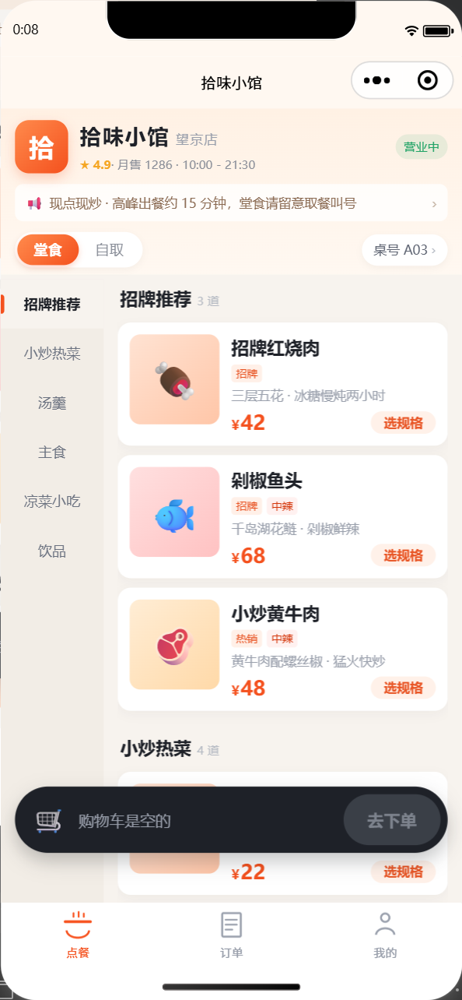
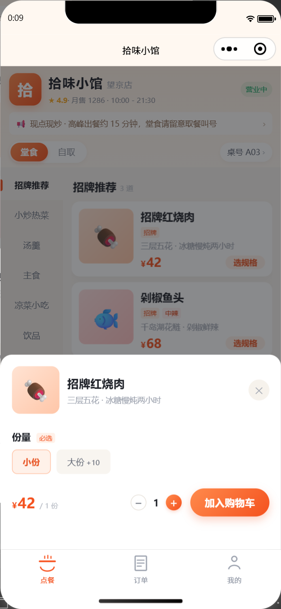
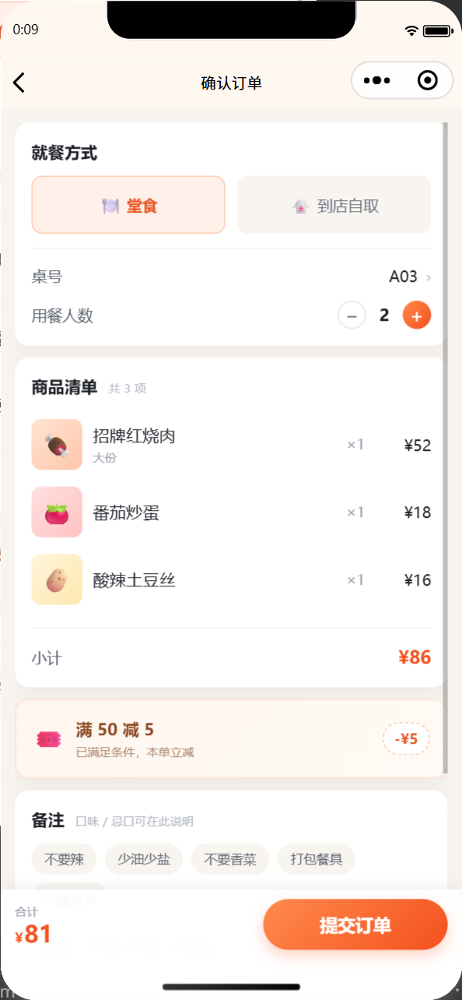
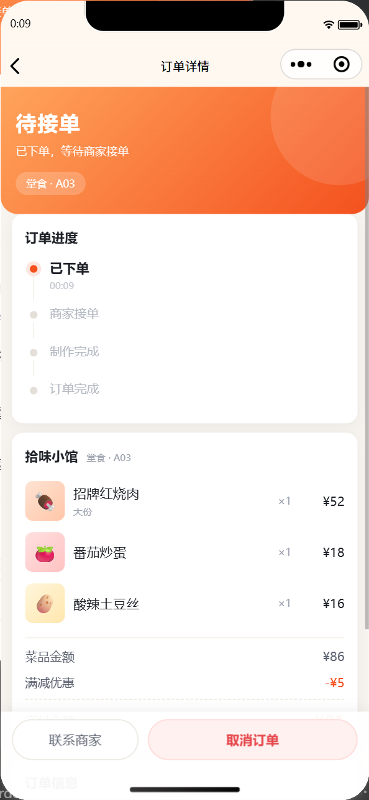
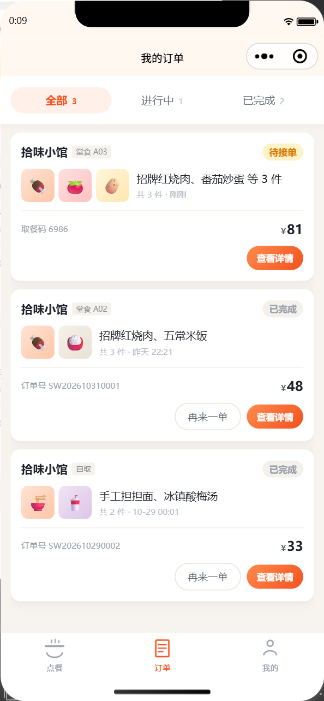
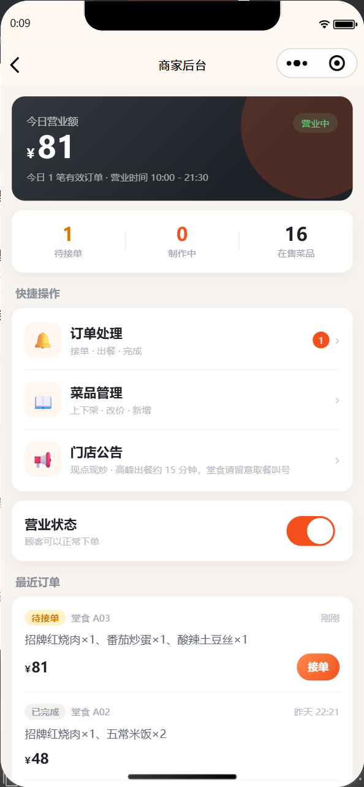

# 拾味小馆 · 线上点餐小程序

一套可直接导入微信开发者工具运行的原生小程序，包含**顾客点餐端**和**商家管理后台**。
没有第三方依赖、没有构建步骤，所有数据先落在本地缓存里，打开就能完整体验「点菜 → 下单 → 接单 → 出餐」的闭环。

- 技术栈：微信小程序原生（WXML / WXSS / JS，CommonJS 模块）
- 页面数量：9 个（3 个 tab 页 + 6 个功能页）
- 基础库：建议 2.12.0 以上（用到了 `scroll-view` 的 `enhanced` 属性）

---

## 一、当前状态：已在本机跑通

- 已导入微信开发者工具（Stable 2.02）并**编译通过**（代码包 122.7 KB）。
- 已在模拟器中跑完整条链路：点餐 → 选规格 → 购物车 → 确认订单 → 提交 → 订单详情 → 订单列表 → 商家后台，**0 异常**。
- 模拟器真实截图在 `screenshots/`：`mp-menu.png`、`mp-spec.png`、`mp-confirm.png`、`mp-order-detail.png`、`mp-orders.png`、`mp-admin.png`。
- 界面预览：`preview.html`（单文件，浏览器直接打开）。

项目里填的是本机账号的 AppID：`wxf21f5224495372f6`。

### 如果模拟器面板没显示

这版开发者工具默认是「编辑器」布局，模拟器面板可能被收起来了。任选一种：

1. 点顶部菜单 **界面 → 模拟器**；
2. 或按 **Ctrl + B** 重新编译，通常会把模拟器带出来；
3. 或直接关掉开发者工具重新打开项目。

### 重新导入

1. 打开微信开发者工具 → **导入项目** → 目录选择本文件夹 `shiwei-diancan`。
2. AppID 保持 `wxf21f5224495372f6`（或换你自己的）。
3. 直接编译，无需配置服务器域名（不请求任何网络接口）。

**界面预览（不用装开发者工具）**：双击 `preview.html`，
这是一个单文件 HTML，用浏览器打开就能看到 4 个核心界面的效果。

### 截图

| 点餐首页 | 规格弹窗 | 确认订单 |
| --- | --- | --- |
|  |  |  |

| 订单详情 | 订单列表 | 商家后台 |
| --- | --- | --- |
|  |  |  |

---

## 二、目录结构

```
shiwei-diancan/
├── app.js                     # 启动时初始化演示数据
├── app.json                   # 页面注册、tabBar、窗口样式
├── app.wxss                   # 设计变量 + 通用样式（卡片/按钮/标签/空状态）
├── project.config.json
├── sitemap.json
├── images/                    # tabBar 图标（脚本生成）
├── screenshots/               # 模拟器真实截图
├── preview.html               # 单文件界面预览（浏览器打开）
├── tools/                     # 静态检查 + 数据层自测脚本
├── utils/
│   ├── store.js               # 数据层：菜单、购物车、订单、门店设置、统计
│   └── util.js                # 金额/时间格式化、订单号、取餐码
└── pages/
    ├── menu/                  # ① 点餐首页（分类联动 + 规格弹窗 + 购物车）
    ├── confirm/               # ② 确认订单（就餐方式/人数/备注/满减）
    ├── orders/                # ③ 我的订单（全部/进行中/已完成）
    ├── order-detail/          # ④ 订单详情（状态时间轴/取餐码/轮询）
    ├── mine/                  # ⑤ 我的（统计/入口/重置数据）
    ├── admin/                 # ⑥ 商家后台（密码锁/今日概览/营业开关）
    ├── admin-orders/          # ⑦ 订单处理（接单/出餐/完成/取消）
    ├── admin-dishes/          # ⑧ 菜品管理（筛选/上下架/编辑/新增）
    └── admin-dish-edit/       # ⑨ 菜品编辑（名称/价格/图标/标签/规格模板）
```

---

## 三、功能清单

### 顾客端

| 模块 | 能力 |
| --- | --- |
| 门店头部 | 评分、月售、营业时间、营业状态、可点击查看的公告 |
| 就餐方式 | 堂食 / 到店自取切换，堂食可选桌号（A01–B04） |
| 菜单 | 左侧分类 + 右侧菜品双列联动：点分类滚动定位，滑动菜单自动高亮分类 |
| 规格 | 份量、辣度、温度、加料；加价实时计算，支持一次加多份 |
| 购物车 | 同菜品同规格自动合并；悬浮购物车栏显示数量与合计；可展开面板增减、清空 |
| 确认订单 | 就餐方式、用餐人数、桌号、备注快捷标签、满 50 减 5、自取打包费 |
| 下单 | 模拟支付；生成订单号、4 位取餐码、状态时间轴；下单后自动清空购物车 |
| 订单列表 | 全部 / 进行中 / 已完成 三个筛选，展示菜品缩略图与取餐码，支持「再来一单」 |
| 订单详情 | 状态头图、取餐码、进度时间轴、金额明细、订单信息；**每 5 秒自动刷新**商家处理进度；待接单可取消；可复制订单号、拨打门店电话 |

### 商家端（我的 → 商家后台，演示密码 **8888**）

| 模块 | 能力 |
| --- | --- |
| 今日概览 | 今日营业额、有效订单数；待接单 / 制作中 / 在售菜品三项指标 |
| 营业状态 | 一键开关；休息时顾客端会拦截加购与下单 |
| 门店公告 | 底部弹层编辑，保存后顾客端头部立即生效 |
| 订单处理 | 待接单 / 制作中 / 待取餐 / 全部；接单 → 完成制作 → 完成订单，或取消订单 |
| 菜品管理 | 分类筛选、上下架开关、按菜品编辑、新增 |
| 菜品编辑 | 名称、价格、分类、描述、图标（18 个 emoji + 配色）、标签多选、规格模板、上架状态、删除 |

> 顾客端与商家端共用同一份本地数据：在后台接单后，回到顾客端订单详情页，5 秒内即可看到状态自动推进。

---

## 四、三分钟演示动线

1. **点餐**：`招牌红烧肉` 点「选规格」→ 选大份 → 加入购物车；再点两份 `五常米饭`。
2. **下单**：点底部「去下单」→ 确认桌号与人数 → 填备注 →「提交订单」。
3. **看进度**：自动跳到订单详情，状态为「待接单」，显示取餐码。
4. **商家接单**：`我的` → `商家后台` → 输入 `8888` → 在「最近订单」点「接单」，再进「订单处理」点「完成制作」。
5. **回到顾客端**：返回订单详情，几秒内状态变为「制作中 / 待取餐」。
6. **验收后台**：后台修改菜品价格或上下架、切换营业状态、改公告，顾客端刷新后同步变化。

---

## 五、数据说明

全部数据保存在本地缓存，key 定义在 `utils/store.js`：

| key | 内容 |
| --- | --- |
| `sw_settings_v1` | 门店信息、桌号、打包费、满减规则、管理密码 |
| `sw_categories_v1` | 菜品分类 |
| `sw_dishes_v1` | 菜品（价格、标签、规格、上架状态） |
| `sw_cart_v1` | 购物车 |
| `sw_orders_v1` | 订单（含时间轴、取餐码） |
| `sw_seeded_v1` | 是否已初始化演示数据 |

- 首次启动会写入 16 道菜、6 个分类和 2 条历史订单，方便后台有数据可看。
- **重置**：`我的 → 重置演示数据`，或在开发者工具里「清缓存 → 清除数据缓存」。
- 菜品展示图用的是 emoji + 渐变色块（无图片资源、加载快、风格统一）。
  想换成真实照片：给菜品加一个 `image` 字段，把 `pages/menu/menu.wxml` 里 `.dish-pic` 的
  `view` 换成 `<image src="{{dish.image}}" mode="aspectFill" />` 即可。

---

## 六、换成自己的店

1. **菜单**：改 `utils/store.js` 里的 `DEFAULT_DISHES`（价格、描述、标签、`specs` 规格）和 `DEFAULT_CATEGORIES`。
2. **门店信息**：改 `DEFAULT_SETTINGS`（店名、电话、营业时间、桌号、打包费、满减、`adminPin`）。
3. **配色**：改 `app.wxss` 顶部的 CSS 变量（`--brand` 主色等），全局生效。
4. 改完在开发者工具里清一次缓存，重新编译。

---

## 七、自检脚本（可选）

`tools/` 下有两个不依赖微信开发者工具的小工具：

```bash
# 静态检查：JSON/JS 语法、页面文件是否齐全、WXML 标签闭合、事件是否有实现、跳转路径是否注册、WXSS 花括号
node tools/check-miniprogram.js

# 数据层单元测试：购物车合并、下单金额、状态流转、统计、重置（用内存 storage 模拟 wx）
node tools/test-store.js
```

当前状态：静态检查 9 个页面 / 14 个 JS / 9 个 WXML / 10 个 WXSS 全部通过；数据层 13 项用例全部通过。

---

## 八、如果要正式上线，还需要补

当前版本是**可演示的前端闭环**，数据在本地。真实上线建议按下面顺序补：

1. **后端 + 数据库**：菜单、订单、桌台落库（云开发 CloudBase 或自建 Node/Java 服务）。
2. **微信登录**：`wx.login` 换 openid，订单与用户绑定。
3. **微信支付**：需要企业主体、商户号，接入统一下单 + 支付回调，把「模拟支付」替换掉。
4. **实时性**：订单状态由轮询改为 WebSocket 或云开发实时数据库监听。
5. **后厨/小票**：云打印机或后厨屏，接单后自动出单。
6. **运营能力**：优惠券、会员储值、库存沽清、多门店、评价体系。
